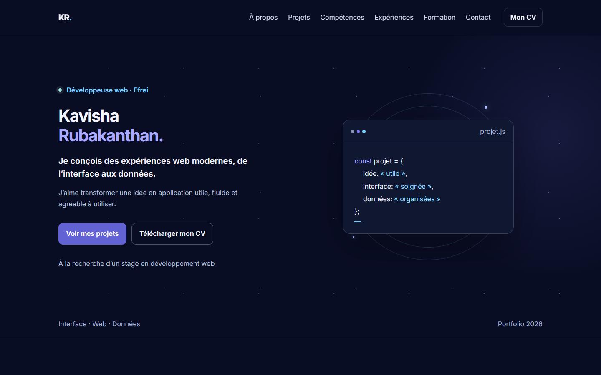
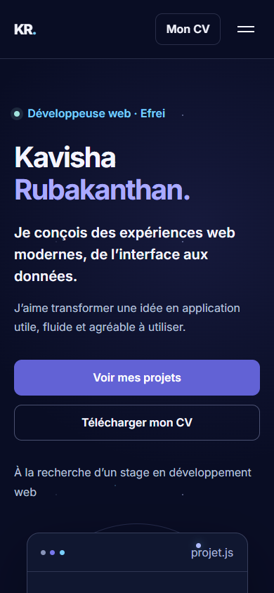

# Portfolio de Kavisha Rubakanthan

Une proposition de portfolio pour présenter mon parcours en développement web, mes expériences et mes projets. Cette branche contient une version d’aperçu au style spatial épuré.





## Utilisation

Le site est statique et ne nécessite pas d’installation. Pour le prévisualiser, lancer un serveur HTTP dans ce dossier, par exemple :

```sh
python -m http.server 8000
```

Ouvrir ensuite `http://localhost:8000` dans un navigateur.

## Fichiers de cette proposition

- `index.html` : contenu, navigation et sections du portfolio.
- `minimal.css` : palette, mise en page responsive et animations.
- `minimal.js` : menu mobile, progression de lecture et copie de l’adresse e-mail.
- `images/` et `docs/` : visuels des projets et captures de présentation.
- `demos/rk/` : démonstration du prototype RK Supermarket avec données fictives locales au navigateur.

Le projet StreamFlix est accessible via son propre site. La démo RK ne transmet aucune commande réelle. Les anciens fichiers de styles et scripts du portfolio sont conservés pour retrouver les versions antérieures ; cette proposition ne les charge pas.
